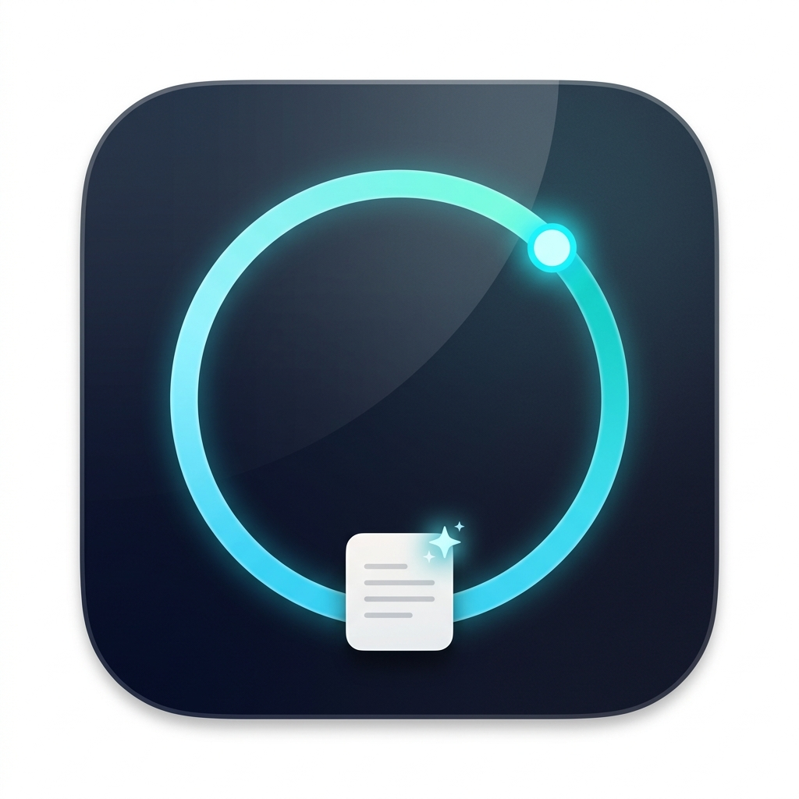

<p align="center">
  
</p>

# FloatingTimers

> macOS 화면 위에 항상 떠 있는 멀티 타이머 + AI 메모 생산성 도구


FloatingTimers는 화면 위에 작은 원형 타이머 HUD와 AI 플로팅 메모를 띄워 놓을 수 있는 macOS 전용 앱입니다.
모든 앱 위에 항상 표시되며 Space(데스크톱) 전환에도 따라다닙니다.

> 🎯 **화면 공유·녹화에 보이지 않습니다.** Zoom, Google Meet, Teams 등으로 화면을 공유해도 HUD는 공유 화면에 나타나지 않습니다.

## ✨ 주요 기능

### 🕐 플로팅 타이머
- 원형 프로그레스 HUD가 화면 위에 항상 표시
- 더블 클릭으로 시작/멈춤, 우클릭 컨텍스트 메뉴
- 타이머 여러 개를 하나의 **묶음**으로 그룹화
- 최소화하면 작은 캡슐로 변환

### 🤖 AI 플로팅 메모
- 화면 캡처 + AI 분석 (OpenAI / Gemini 지원)
- 글로벌 단축키 `Ctrl+;`로 빠른 캡처
- 대화 형태로 질문/답변이 카드에 누적
- 메모별 기본 프롬프트 설정 가능
- API 키 10개 슬롯 관리 (Keychain 보안 저장)

### 🔒 화면 공유 · 녹화 안전
- **Zoom, Meet, Teams 등 화면 공유 시 HUD가 보이지 않음** — 나만 볼 수 있음
- Dock에 아이콘이 표시되지 않는 액세서리 앱 (LSUIElement)

### 🎨 UI/UX
- 다크 모드 전용 glassmorphism 디자인
- 투명도 조절 슬라이더
- 앱 상태 자동 저장/복원

---

## 🛠️ 빌드 & 실행

### 요구사항
- macOS 14.0+
- Swift 6.2+
- Xcode 16+ (선택 — CLI로도 빌드 가능)

### Swift Package Manager로 빌드

```bash
# 디버그 빌드
swift build

# 릴리스 빌드 (.app 번들 생성)
./build-app.sh

# 빌드된 앱 실행
open dist/FloatingTimers.app
```

### Xcode에서 열기

```bash
open Package.swift
```

Xcode가 자동으로 Swift Package로 인식합니다. `FloatingTimers` 스킴을 선택하고 실행하세요.

---

## 📁 프로젝트 구조

```
Sources/FloatingTimers/
├── FloatingTimersApp.swift      # 앱 진입점
├── AppDelegate.swift            # NSApplicationDelegate (액세서리 앱 설정)
├── Models/                      # 데이터 모델
│   ├── TimerItem.swift          # 타이머 아이템
│   ├── TimerGroup.swift         # 타이머 그룹
│   ├── MemoItem.swift           # AI 메모 아이템
│   ├── AIProvider.swift         # AI 제공자 (OpenAI/Gemini)
│   └── ...
├── Stores/                      # 상태 관리
│   └── TimerStore.swift         # 중앙 @MainActor 스토어
├── Services/                    # 비즈니스 로직
│   ├── VisionAssistantService.swift  # AI API 호출
│   ├── ScreenCaptureService.swift    # 화면 캡처 (ScreenCaptureKit)
│   ├── AISettingsStore.swift         # AI 설정 영속화
│   └── ...
├── Views/                       # SwiftUI 뷰
│   ├── ContentView.swift        # 메인 레이아웃 (~160줄)
│   ├── Components/              # 공유 UI 컴포넌트
│   ├── Sections/                # 메인 창 섹션 뷰
│   ├── Rows/                    # 목록 행 뷰
│   ├── FloatingTimerView.swift  # 플로팅 타이머 HUD
│   ├── FloatingMemoView.swift   # 플로팅 메모 HUD
│   └── ...
└── Windows/                     # AppKit 윈도우 관리
    ├── FloatingTimerPanel.swift  # NSPanel 서브클래스
    └── FloatingTimerWindowManager.swift  # 패널 생명주기 관리
```

---

## ⚙️ 아키텍처

**Model-View-Store** 패턴을 사용합니다.

- **TimerStore** (`@MainActor ObservableObject`): 앱의 모든 상태를 관리하는 중앙 저장소
- **프로토콜 기반 DI**: `AISettingsPersisting`, `ScreenCaptureServing`, `VisionAssistantStreaming` 등 테스트 용이한 설계
- **Swift 6 Strict Concurrency**: 모든 UI 변경은 `@MainActor`에서 실행

---

## 🔑 AI 설정

1. 설정에서 **OpenAI** 또는 **Gemini** 선택
2. API 키를 슬롯에 입력 (최대 10개)
3. 모델명 설정
4. "연결 확인"으로 테스트

> ⚠️ API 키는 macOS Keychain에 안전하게 저장됩니다.

### 화면 캡처 권한

AI 메모의 화면 캡처 기능을 사용하려면 **시스템 설정 → 개인 정보 보호 → 화면 기록**에서 FloatingTimers를 허용해야 합니다.

---

## 📄 라이선스

[MIT License](LICENSE)

---

---

# FloatingTimers (English)

> Always-on-top multi-timer HUD + AI memo productivity tool for macOS

FloatingTimers is a macOS-exclusive app that floats small circular timer HUDs and AI-powered memo cards on top of all windows. They follow you across Spaces and full-screen apps.

> 🎯 **Invisible to screen sharing & recording.** HUDs are automatically excluded from Zoom, Google Meet, Teams, and other screen capture.

## ✨ Key Features

### 🕐 Floating Timers
- Circular progress HUD always visible on screen
- Double-click to start/pause, right-click context menu
- Group multiple timers into a single HUD bundle
- Minimize to a compact capsule

### 🤖 AI Floating Memos
- Screen capture + AI analysis (OpenAI / Gemini)
- Global hotkey `Ctrl+;` for quick capture
- Conversation-style Q&A accumulated on each card
- Per-memo custom prompt configuration
- Up to 10 API key slots (securely stored in Keychain)

### 🔒 Screen Sharing Safe
- **Invisible to Zoom, Meet, Teams screen sharing** — only you can see the HUDs
- Runs as an accessory app (no Dock icon)

### 🎨 UI/UX
- Dark mode glassmorphism design
- Opacity slider for transparency control
- Auto-save and restore app state

## 🛠️ Build & Run

### Requirements
- macOS 14.0+
- Swift 6.2+
- Xcode 16+ (optional — CLI build supported)

### Build with Swift Package Manager

```bash
# Debug build
swift build

# Release build (.app bundle)
./build-app.sh

# Run the built app
open dist/FloatingTimers.app
```

### Open in Xcode

```bash
open Package.swift
```

## ⚙️ Architecture

Uses a **Model-View-Store** pattern with Swift 6 strict concurrency.

- **TimerStore** (`@MainActor ObservableObject`): Central state manager
- **Protocol-based DI**: `AISettingsPersisting`, `ScreenCaptureServing`, `VisionAssistantStreaming` for testability
- **28 unit tests** covering core store logic

## 📄 License

[MIT License](LICENSE)
